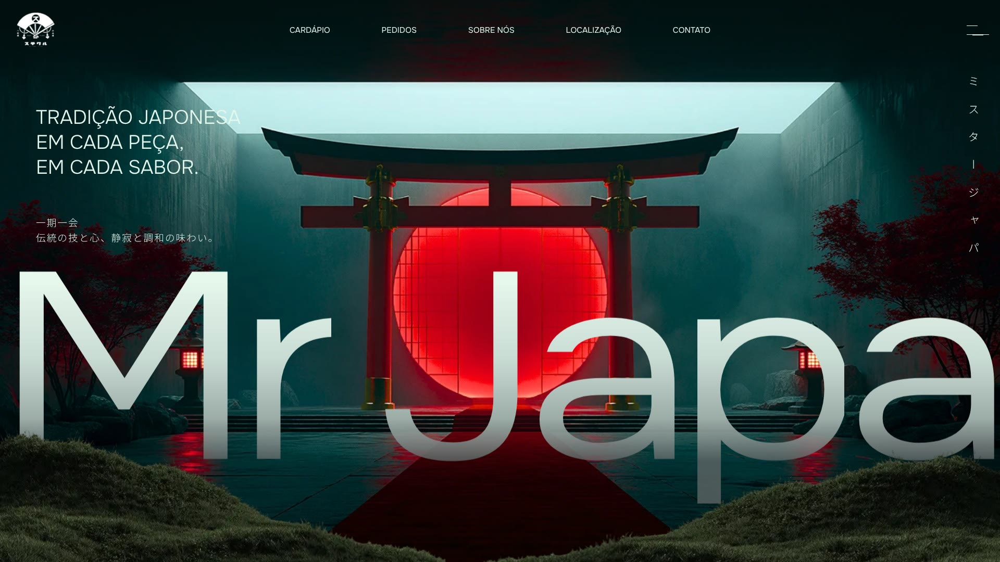
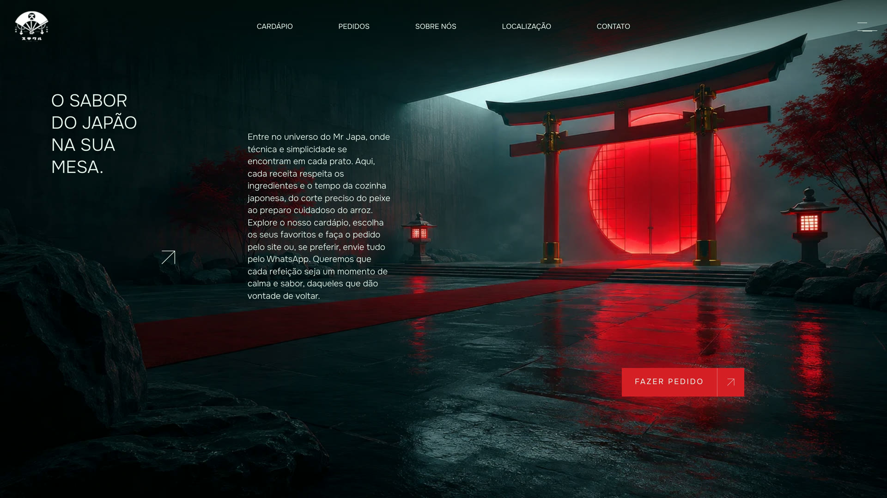
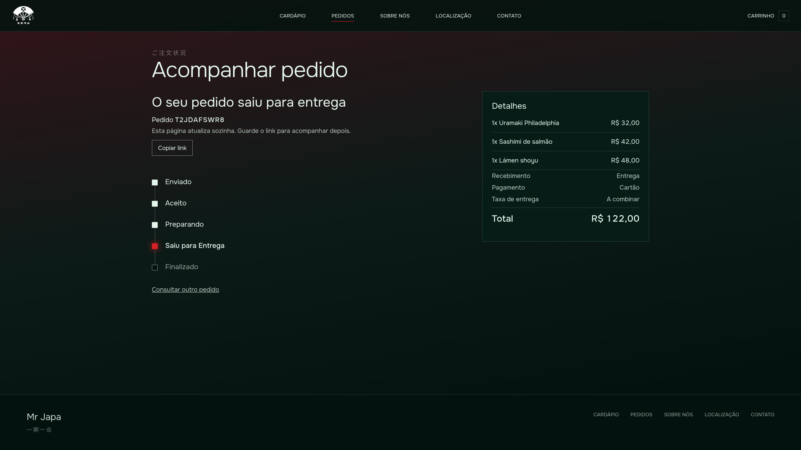
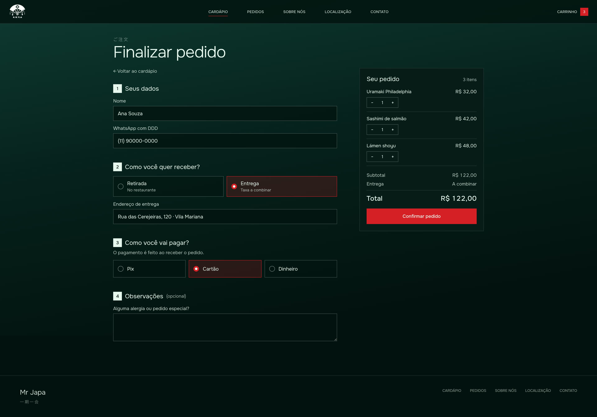
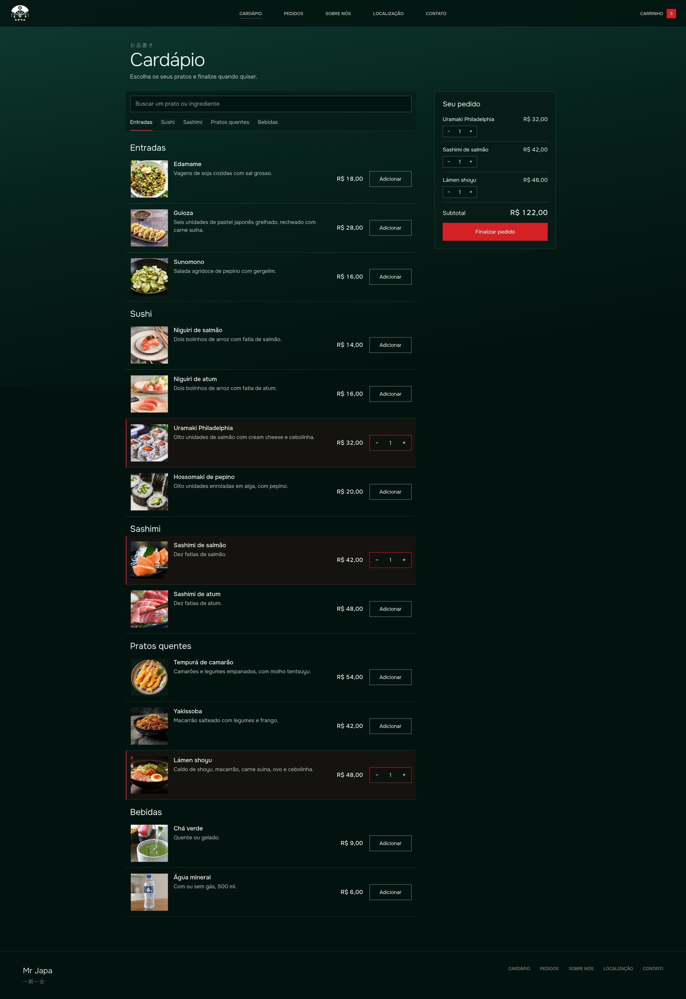
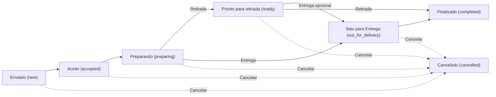

<p align="center">
  
</p>

<p align="center">
  <sub>ミ ス タ ー ジ ャ パ &nbsp;&nbsp;·&nbsp;&nbsp; 一 期 一 会</sub>
</p>

<h1 align="center">Mr Japa</h1>

<p align="center">
  <strong>Tradição japonesa em cada peça, em cada sabor.</strong><br />
  Plataforma completa do restaurante: hero cinematográfico em torno do torii, cardápio interativo,<br />
  carrinho, pedidos pelo site ou WhatsApp, rastreio ao vivo e painel administrativo.
</p>

<p align="center">
  
  
  
  
  
  
  
</p>

<p align="center">
  <a href="#visão-geral">Visão geral</a> &nbsp;·&nbsp;
  <a href="#telas-da-experiência">Telas</a> &nbsp;·&nbsp;
  <a href="#identidade-visual">Identidade visual</a> &nbsp;·&nbsp;
  <a href="#arquitetura-e-fluxo-do-pedido">Fluxo do pedido</a> &nbsp;·&nbsp;
  <a href="#rodando-em-desenvolvimento">Desenvolvimento</a> &nbsp;·&nbsp;
  <a href="#configuração-do-restaurante">Configuração</a> &nbsp;·&nbsp;
  <a href="#cardápio-e-fotos">Cardápio</a> &nbsp;·&nbsp;
  <a href="#produção">Produção</a> &nbsp;·&nbsp;
  <a href="#testes-e-verificação">Testes</a> &nbsp;·&nbsp;
  <a href="#licença">Licença</a>
</p>

---

## Visão geral
<sub>概要 · Experiência digital minimalista, precisa e cerimonial</sub>

O projeto **Mr Japa** é estruturado em:

| Módulo | Stack | Responsabilidade |
|---|---|---|
| [`client/`](client) | Next.js 16, React 19, TypeScript, GSAP | Hero com órbita 3D, cardápio com busca e zoom, checkout, rastreio e painel `/admin` |
| [`server/`](server) | Go 1.27, Fiber v3, SQLite (`modernc`) | API REST, cálculo de preços no servidor, persistência WAL, rate limit e notificações |
| [`docs/`](docs) | Markdown, Screenshots | Documentação, ativos visuais e capturas da interface |

### Rotas da aplicação

| Rota | Eyebrow | Descrição |
|---|---|---|
| `/` | `ミスタージャパ` | Hero em duas cenas com animação `GSAP` + `ScrollTrigger` e botão `FAZER PEDIDO` |
| `/cardapio` | `お品書き` | Catálogo por categorias, busca sem acentos, zoom de fotos e painel `Seu pedido` |
| `/cardapio/finalizar` | `ご注文` | Checkout em 4 etapas: dados, retirada/entrega, pagamento (`Pix`, `Cartão`, `Dinheiro`) e envio |
| `/pedidos` | `ご注文状況` | Consulta de pedido pelo código alfanumérico de 10 caracteres |
| `/pedidos/[code]` | `ご注文状況` | Linha do tempo ao vivo com atualização automática a cada `15 s` |
| `/sobre` | `私たちについて` | Filosofia da casa (`一期一会`) e os três pilares: Técnica, Simplicidade e Cuidado |
| `/localizacao` | `アクセス` | Endereço, link para mapa e horários configurados via ambiente |
| `/contato` | `お問い合わせ` | Telefone, e-mail, Instagram e orientação de pedido via WhatsApp |
| `/admin` | — | Gestão de pedidos (polling a cada `10 s`) e edição de preços, fotos e disponibilidade |

---

## Telas da experiência
<sub>画面構成 · Vídeo promocional e capturas reais da interface</sub>

<p align="center">
  <video src="docs/promo.mp4" controls poster="docs/screenshots/hero-banner.jpg" width="100%">
    <a href="docs/promo.mp4">
      
    </a>
  </video>
  <br />
  <sub>
    <strong>Vídeo promocional da plataforma (40 s · 1080p)</strong> &nbsp;·&nbsp;
    <a href="docs/promo.mp4">Assistir / baixar em MP4 com áudio (<code>docs/promo.mp4</code>)</a>
  </sub>
</p>

<table>
  <tr>
    <td width="50%" align="center">
      
      <br />
      <sub><strong>Hero · Cena 2</strong> — Órbita de câmera no scroll e chamada principal</sub>
    </td>
    <td width="50%" align="center">
      
      <br />
      <sub><strong>Acompanhar pedido</strong> (<code>/pedidos/[code]</code>) — Status ao vivo com marcador carmesim</sub>
    </td>
  </tr>
</table>

<details>
  <summary><strong>Ver mais telas: Cardápio e Finalização em 4 passos</strong></summary>
  <br />
  <table>
    <tr>
      <td width="50%" valign="top" align="center">
        
        <br />
        <sub><strong>Checkout</strong> (<code>/cardapio/finalizar</code>) — Retirada ou entrega e pagamento ao receber</sub>
      </td>
      <td width="50%" valign="top" align="center">
        
        <br />
        <sub><strong>Cardápio</strong> (<code>/cardapio</code>) — 5 categorias, busca e painel <em>Seu pedido</em></sub>
      </td>
    </tr>
  </table>
</details>

---

## Identidade visual
<sub>静寂と調和 · Tokens definidos em <code>client/app/globals.css</code> e <code>client/app/layout.tsx</code></sub>

A direção visual **Sumi Night** parte da atmosfera noturna do torii iluminado pelo sol vermelho: superfícies escuras em verde-nanquim, cantos retos, fios finos e um único ponto de destaque em carmesim.

| Cor | Token | Valor | Papel na interface |
|---|---|---|---|
|  | `--ink` | `#03120f` | Fundo principal (*sumi* profundo) |
|  | `--panel` | `#071c18` | Superfícies de painéis e cards |
|  | `--mint` | `#e6f7ee` | Texto principal e bordas de foco |
|  | `--muted` | `rgb(230 247 238 / 0.62)` | Textos secundários e cabeçalhos em kana |
|  | `--line` | `rgb(230 247 238 / 0.14)` | Divisórias e contornos sutis |
|  | `--accent` | `#d61f26` | Sol do torii, CTAs principais, seleção ativa e etapa atual |

- **Tipografia**: `Onest` para textos em português e `Noto Sans JP` (peso `300`) para títulos e expressões em japonês.
- **Curva de transição**: `cubic-bezier(0.2, 0.7, 0.2, 1)` em microinterações, links e entradas de cena.

---

## Arquitetura e fluxo do pedido
<sub>注文の流れ · Da escolha no cardápio à entrega</sub>

1. O cliente navega em `/cardapio` e monta o carrinho (persistido em `localStorage` sob `mrjapa:cart` apenas com IDs e quantidades — **preços são sempre calculados no servidor**).
2. Em `/cardapio/finalizar`, informa nome, WhatsApp com DDD, modalidade (`pickup` ou `delivery`), forma de pagamento na entrega/retirada (`Pix`, `Cartão` ou `Dinheiro`) e observações opcionais.
3. Pode confirmar direto pelo site ou, quando `WHATSAPP_NUMBER` estiver definido, enviar a mensagem formatada pelo botão **Enviar pelo WhatsApp**.
4. A API gera um código único de 10 caracteres (alfabeto sem caracteres ambíguos) e o cliente acompanha a evolução em `/pedidos` ou `/pedidos/CODIGO`.
5. O restaurante gerencia os pedidos e o cardápio em `/admin`.



> [!WARNING]
> **Bot do WhatsApp (ainda não implementado)**
>
> Ao criar um pedido, a API monta a mensagem para o cliente em [`server/internal/notify/notify.go`](server/internal/notify/notify.go) (função `OrderPlaced`, com código e link de acompanhamento) e chama `Notifier.Send` em goroutine. Hoje o envio usa `notify.None`, portanto **nenhuma mensagem automática chega ao cliente**.
>
> Para ativar o bot, implemente a interface `notify.Notifier` e passe sua instância em `Options.Notifier` dentro de [`server/main.go`](server/main.go), configurando também `SITE_URL` com o endereço público do site.

---

## Rodando em desenvolvimento
<sub>開発環境 · API Go e cliente Next.js em paralelo</sub>

Em dois terminais a partir da raiz do projeto:

```sh
# Terminal 1 — API Go + SQLite em http://127.0.0.1:8080
cd server && cp .env.example .env && go run .
```

```sh
# Terminal 2 — Cliente Next.js em http://localhost:3000
cd client && pnpm install && pnpm dev
```

- O Next.js encaminha automaticamente todas as chamadas `/api/*` para a API Go via `rewrites` em [`client/next.config.ts`](client/next.config.ts).
- O painel administrativo fica em `/admin` e exige o `ADMIN_TOKEN` definido em `server/.env`. Sem um token configurado, o painel permanece desativado (`503`).

---

## Configuração do restaurante
<sub>店舗設定 · Variáveis de ambiente em <code>server/.env</code></sub>

Toda a configuração pública e operacional do restaurante vem de `server/.env` (use [`server/.env.example`](server/.env.example) como modelo).

| Variável | Padrão | Descrição |
|---|---|---|
| `API_ADDR` | `127.0.0.1:8080` | Endereço e porta em que a API Fiber escuta |
| `DATABASE_PATH` | `data/mrjapa.db` | Caminho do banco SQLite (criado automaticamente) |
| `SITE_URL` | `http://localhost:3000` | URL pública usada no link de acompanhamento enviado pelo bot |
| `ADMIN_TOKEN` | *(vazio)* | Código de acesso do painel `/admin` (`openssl rand -hex 32`) |
| `WHATSAPP_NUMBER` | *(vazio)* | Número com DDI + DDD, só dígitos (ex.: `5511999999999`) |
| `DELIVERY_ENABLED` | `true` | Habilita ou desabilita a opção de entrega |
| `DELIVERY_FEE_CENTS` | `0` | Taxa de entrega em centavos (`0` exibe *"a combinar"*) |
| `RESTAURANT_ADDRESS` | *(vazio)* | Endereço exibido na página `/localizacao` |
| `RESTAURANT_HOURS` | *(vazio)* | Horário de funcionamento exibido em `/localizacao` |
| `RESTAURANT_PHONE` | *(vazio)* | Telefone exibido em `/contato` |
| `RESTAURANT_EMAIL` | *(vazio)* | E-mail exibido em `/contato` |
| `RESTAURANT_INSTAGRAM` | *(vazio)* | Usuário do Instagram (com ou sem `@`) exibido em `/contato` |
| `RESTAURANT_MAP_URL` | *(vazio)* | Link externo para o mapa na página `/localizacao` |

> [!NOTE]
> Campos vazios são omitidos automaticamente nas páginas do site, e sem `WHATSAPP_NUMBER` o botão **"Enviar pelo WhatsApp"** não é exibido. **Reinicie a API** após qualquer alteração em `server/.env`.

---

## Cardápio e fotos
<sub>お品書き · Seed inicial, edição pelo painel e imagens</sub>

O cardápio inicial vem de [`server/internal/store/seed/menu.json`](server/internal/store/seed/menu.json) com **5 categorias e 14 pratos** (`Entradas`, `Sushi`, `Sashimi`, `Pratos quentes` e `Bebidas`), mas esse arquivo só é lido quando o banco SQLite está vazio.

- Editar `menu.json` **não altera** um banco já existente.
- Para reaplicar o arquivo de seed do zero: apague `server/data/` (**isso também apaga pedidos e edições feitas pelo painel**), recompile e reinicie a API.
- Preços, disponibilidade e fotos podem ser atualizados a qualquer momento pela aba **Cardápio** em `/admin`, sem apagar nenhum dado.

### Fotos dos pratos

1. Salve a imagem dentro de [`client/public/menu/`](client/public/menu) (ex.: `edamame.jpg`).
2. Informe o caminho relativo `/menu/edamame.jpg` no campo **Foto** da aba Cardápio em `/admin` (aceita `.jpg`, `.jpeg`, `.png`, `.webp` e `.avif`).
3. Apenas colocar o arquivo na pasta não basta: sem o caminho salvo no banco, o prato continua exibindo o espaço reservado com o nome em japonês.
4. Clicar na foto no cardápio abre a imagem ampliada. Em produção, novos arquivos adicionados em `public/menu/` exigem reiniciar o Next.js.

---

## API HTTP
<sub>API · Rotas expostas pelo servidor Go em <code>server/internal/api/api.go</code></sub>

| Método | Rota | Acesso | Descrição |
|---|---|---|---|
| `GET` | `/api/health` | Público | Verificação de saúde (`{"status":"ok"}`) |
| `GET` | `/api/restaurant` | Público | Dados do restaurante, taxa e flags (`whatsapp_enabled`, `delivery_enabled`) |
| `GET` | `/api/menu` | Público | Categorias e itens ordenados do cardápio |
| `POST` | `/api/orders` | Público (`20/min`) | Valida e cria pedido calculando preços no servidor |
| `GET` | `/api/orders/:code` | Público | Consulta pública do pedido (sem dados pessoais do cliente) |
| `GET` | `/api/admin/orders` | `Bearer ADMIN_TOKEN` | Lista os 100 pedidos mais recentes |
| `PATCH` | `/api/admin/orders/:code` | `Bearer ADMIN_TOKEN` | Avança ou cancela o status do pedido conforme máquina de estados |
| `PATCH` | `/api/admin/items/:id` | `Bearer ADMIN_TOKEN` | Atualiza `price_cents`, `available` e `image` de um prato |

---

## Produção
<sub>本番環境 · Checklist de build, proxy reverso e backup</sub>

> [!IMPORTANT]
> Defina `API_URL` tanto no **build** quanto na **execução** do cliente Next.js: a rota de proxy `/api/:path*` é fixada durante o `next build`.

- **Proxy reverso**: coloque `nginx`, `Caddy` ou equivalente na frente do Next.js sobrescrevendo `X-Forwarded-For` com o IP real do visitante. O Next repassa esse cabeçalho à API, que o utiliza no limite de **20 pedidos por minuto por IP**. Sem esse proxy, todos os clientes compartilham o mesmo limite.
- **Confiança de proxy na API**: por padrão, a API só confia em `X-Forwarded-For` vindo de loopback (`TrustProxyConfig{Loopback: true}`), devendo rodar na mesma máquina que o Next.js. Para servidores separados, ajuste `TrustProxyConfig` em [`server/internal/api/api.go`](server/internal/api/api.go).
- **Backup**: faça backup recorrente do diretório `server/data/` (SQLite em modo WAL).

---

## Testes e verificação
<sub>検証 · Suíte Go e checagens do frontend</sub>

```sh
# Testes unitários e de integração da API e do SQLite
cd server && go test ./...

# Tipagem, lint e build de produção do Next.js
cd client && pnpm exec tsc --noEmit && pnpm exec eslint . && pnpm build
```

### Vídeo promocional

O vídeo de apresentação da plataforma está disponível em [`docs/promo.mp4`](docs/promo.mp4) (`1920×1080`, `30 fps`, com áudio) e em prévia animada em [`docs/screenshots/promo.webp`](docs/screenshots/promo.webp). O projeto Remotion fonte usado na composição fica em `promo/` (ignorado no repositório para manter o clone enxuto).

---

## Licença
<sub>ライセンス · MIT License</sub>

Este projeto está sob a licença [MIT](LICENSE). Consulte o arquivo [LICENSE](LICENSE) para mais detalhes.

---

<p align="center">
  <strong>Mr Japa</strong><br />
  <sub>一期一会 &nbsp;·&nbsp; 伝統の技と心、静寂と調和の味わい。</sub>
</p>
